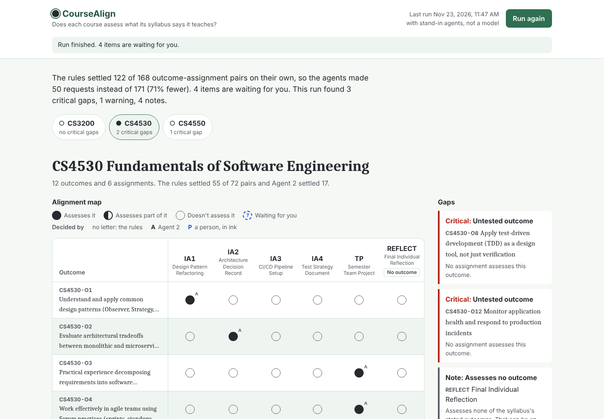
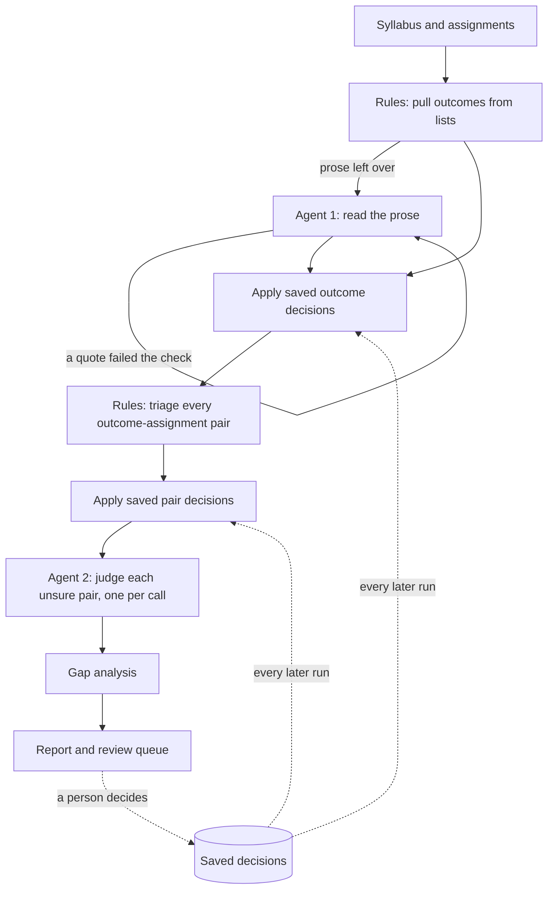

# CourseAlign

**Does each course actually assess what its syllabus says it teaches?**

CourseAlign reads a course's syllabus and its assignments, maps every stated learning outcome to the assignments that assess it, and reports the gaps: outcomes nothing tests, assignments that test nothing the syllabus states, and outcomes tested more shallowly than they promise. Rules settle the clear cases. Two LLM agents handle the rest under checks written in code. A person settles anything the agents aren't sure about, once.

<picture>
  <source media="(prefers-color-scheme: dark)" srcset="docs/dashboard-dark.png">
  
</picture>

## How it works



The pipeline is a LangGraph state machine (`src/coursealign/graph.py`), one run per course.

- **Rules first, agents second.** Deterministic rules extract list-style outcomes and triage every pair. Only the ambiguous cases reach an LLM. On the included data, the rules settle 122 of 168 pairs, which cuts agent requests from 171 to 50.
- **Every agent claim is checked in code.** Agent 1 must quote the syllabus words behind each outcome; Agent 2 must quote the assignment words behind each match. A paraphrase fails the check, the agent gets one retry with the failure spelled out, and anything still failing goes to a person. It never silently becomes "no."
- **Context isolation.** Agent 1 never sees the assignments. Agent 2 sees one pair per call, and not the outcome's Bloom's level, so its judgment of depth isn't anchored to what the outcome claims.
- **Confidence decides what happens next.** At 0.8 and above a verdict passes, from 0.6 to 0.8 it passes flagged for review, and below 0.6 it waits for a person.
- **A second opinion, because confidence isn't enough.** On the first real-model run, every wrong verdict came with confidence 0.85 or higher. With `--second-opinion`, each pair is judged twice, separately, and a pair whose two judgments disagree waits for a person.
- **A busy model doesn't sink the run.** Temporary failures (a 503 or 529 from a busy model, a 429 rate limit, a dropped connection) are retried with exponential backoff and jitter, paced to the rate limit. A pair the model never answers waits for a person, and after three calls in a row fail, calls pause for two minutes instead of each one waiting out its own retries. Agent 1 is the exception: a syllabus read with a section missing would give a wrong gap report, so the run stops with a plain message instead.
- **People decide once.** Decisions are saved by syllabus quote, so they survive re-runs. They apply on every later run and can teach the rules a word that helps every course.
- **Measured, not assumed.** Hand labels score every stage, triage is also scored with no model at all, and a multi-run eval reports how much the agents vary. When Agent 1 splits one stated outcome into parts, pairs are also scored per stated outcome, the level the labels were written at, because scoring each part against the whole outcome's label counts right answers as wrong.

## Quick start

```bash
pip install -r requirements.txt
cd web && npm install && npm run build && cd ..    # builds the dashboard (needs Node.js)
python3 step6_api.py              # dashboard at http://127.0.0.1:8000, API docs at /docs
```

That uses stand-in agents, so it needs no API key. To use a real model:

```bash
export ANTHROPIC_API_KEY=...
COURSEALIGN_LLM=anthropic python3 step6_api.py
```

Or use Gemini's free tier, with a key from Google AI Studio:

```bash
export GEMINI_API_KEY=...
COURSEALIGN_LLM=gemini python3 step6_api.py
```

Requests to Gemini are paced to stay under the free tier's per-minute limit. Set `COURSEALIGN_GEMINI_RPM` to the limit AI Studio shows for your project, and `COURSEALIGN_GEMINI_MODEL` to choose a model. `COURSEALIGN_AGENT1_MODEL` gives Agent 1 its own model: it makes only a few calls a run, and an outcome it misses makes every later stage wrong, so a stronger model with a small daily limit can be worth it (`COURSEALIGN_AGENT1_RPM` paces it, default 5). A request that fails with a temporary error is tried up to 7 times over about one to two minutes; `COURSEALIGN_LLM_ATTEMPTS` changes that. A used-up daily limit stops the run at once instead, since only Google's reset at midnight Pacific fixes it. Real replies are saved (`.cache/llm_replies.json` for Steps 4 and 5 and the dashboard, one file per run for Step 8), so a run cut short by a limit picks up where it stopped; add `--fresh` to Step 4 or Step 8 to ask again.

Add `--courses MIT6005,MIT6170` to Steps 3, 4 and 8 to run and score only those courses, for example a held-out test set.

### Adding a course

Put the syllabus text in `data/syllabi/<course>_<name>.txt`, with the course title on the first line. Write the assignments, and your hand labels, as plain text in `data/ocw/<course>_assignments.txt` and `data/ocw/<course>_labels.txt` (the format is at the top of `import_course.py`), then run `python import_course.py <COURSE>`. Add `--paste` to paste each assignment into the terminal instead of an editor, and `--label` to write the labels by answering questions, one outcome at a time. It writes the JSON and refuses to if a label quote isn't in the syllabus or names an assignment that doesn't exist. Label a course before running any model on it, so the labels can't be shaped by the model's answers.

The stand-in agents, the tests and the demo workspace (`step6_api.py --workspace`) use only the three practice courses (CS3200, CS4530, CS4550), because the stand-ins' answers are written for them. Courses you add run with a real model, alongside the practice courses on your own dashboard.

To rebuild the dashboard after editing it: `cd web && npm install && npm run build`.

## The steps

The project was built in steps, and each step's script still runs and shows its piece on its own.

| Script | What it shows |
|---|---|
| `step1_data_profile.py` | The three courses and their data |
| `step2_stage0.py` | The rules alone: outcome extraction and pair triage, scored against the labels |
| `step3_agent1.py` | Agent 1 reading prose inside the LangGraph graph, with the evidence check and retry |
| `step4_agent2.py` | Agent 2 judging the unsure pairs, then gap analysis |
| `step5_review.py` | The feedback loop: a review, then a second run that applies it (`--interactive` to decide yourself) |
| `step6_api.py` | The API and dashboard (`--check` tours every endpoint without a server) |
| `step8_eval.py` | Several full runs, with the spread of every metric |

Steps 3, 4, 5, and 8 take `--llm anthropic` or `--llm gemini` to use a real model.

## Tests

- `pytest tests/` runs 114 tests: the rules, both agents (with stand-in LLMs), the LLM clients and their retries, the review loop, the service layer, the HTTP API, and color contrast.
- `cd web && npx playwright test` runs 7 end-to-end tests in Chromium, plus axe-core WCAG 2.1 AA checks of every view in light and dark mode.
- GitHub Actions runs all of it on every push (`.github/workflows/ci.yml`).

## Measuring it

With stand-in agents, which answer from the hand labels, the offline numbers are:

| | |
|---|---|
| Pairs decided by rules (labeled outcomes, no model) | 119 of 168, 117 right |
| Agent requests | 50, vs. 171 with no rules |
| Untested outcomes found | 3 of 3, no false alarms |
| Orphan assignments found | 2 of 2, no false alarms |

These test the code, not a model. For real numbers:

```bash
python3 step8_eval.py --llm anthropic --runs 3
```

One caveat matters more than any number above: the three syllabi, the rules, and the labels were written together, so these results are a sanity check, not a benchmark. To measure for real, add syllabi you didn't write (with `POST /api/courses` or as files in `data/`), label them in `data/gold/alignment_labels.json`, and run the eval.

## Held-out test: two MIT OpenCourseWare courses

The practice courses were used to build and tune the pipeline, so they can't show how it does on syllabi it has never seen. So it was run on two real courses it had never seen, with labels fixed before any model run on them and no pipeline changes afterwards: MIT 6.005 Elements of Software Construction (Fall 2008: 6 objectives, 9 assignments) and MIT 6.170 Software Studio (Spring 2013: 4 objectives, 5 assignments). Both agents used Gemini 3.5 Flash Lite, with the second opinion on. The full output is in [docs/heldout_mit_ocw_run.txt](docs/heldout_mit_ocw_run.txt).

| | |
|---|---|
| Stated outcomes found by Agent 1 | 7 of 10 |
| Outcome-assignment pairs matching the labels, per stated outcome | 40 of 43 decided (93%), and 4 more sent to a person |
| Untested outcomes | none in the labels, and no false alarms |
| Orphan assignments | 1 of 1 found (6.170's nanoquizzes), no false alarms |
| Pairs the rules settled before any LLM call | 5 of 108 (4.6%), against 75.6% on the practice courses |

What it shows:

- **The rules don't carry over.** Their vocabulary came from the practice courses' wording and rubric lists, and real handouts use other words and have no rubric lists, so nearly every pair went to Agent 2. The savings measured on the practice courses don't apply to new syllabi.
- **Agent 1 is the weakest stage.** On 6.005 it split the first objective into five parts and skipped the last three objectives (design patterns and technologies, engineering judgment, teamwork). Their 27 pairs were never judged, and they aren't in the 43.
- **The second opinion didn't catch the three wrong pairs.** All three were "not aligned" verdicts that both judgments agreed on, with high confidence (6.005 objective 2 x P3, objective 3 x P1 and P3). A second judgment catches unstable answers, not consistent mistakes.
- Two parts of 6.170's objectives were flagged as untested (problem analysis, and the grasp of design notions) where the labels cover only each whole objective, so those alarms can't be scored.

**How the labels were made.** They were drafted with an AI assistant (Claude) from each assignment's own text, entered with `import_course.py --label`, and fixed before any model run on these courses. No second person checked them, so "matching the labels" means agreeing with that one labeling, not with expert judgment.

**How the scoring changed.** The first run on these courses showed that Agent 1 splits bundled objectives into parts, and that scoring each part against the whole objective's label counts right answers as wrong. Scoring per stated outcome was added after that run. Only the scoring changed, not the model's answers, and the per-part numbers are still printed: 73 of 97 decided pairs.

## Design decisions

- **JSON files, not a database.** The data is small, a diff shows exactly what a review changed, and nothing needs a server to inspect.
- **Reviews are applied between runs, not waited for.** A reviewer may come back days later, so the graph never pauses for a person; it applies whatever is saved when it starts.
- **Replies are cached by exact request in the review loop.** A second run then differs from the first only where a decision changed something, and unchanged requests cost nothing. The eval deliberately skips the cache, since it measures variation.
- **esbuild, not Vite.** One dependency, builds in about 100 ms, and the build that was tested is the build that ships.
- **Offline stand-ins.** `offline_graph.py` runs the same graph without LangGraph, and the fake LLMs need no key, so every test runs anywhere.

## Layout

```
data/            syllabi, assignments, rules, hand labels, review decisions
src/coursealign/ the pipeline: stage0 (rules), agent1, agent2, gaps, review,
                 graph (LangGraph), service + api (FastAPI), report, evaluate
web/             the dashboard: React + TypeScript, built with esbuild
tests/           pytest suites and fixtures
web/e2e/         Playwright end-to-end and accessibility specs
step*.py         one runnable script per build step
docs/            the held-out run's full output
```

## Credits

Course materials for the held-out test come from MIT OpenCourseWare and are used under [CC BY-NC-SA 4.0](https://creativecommons.org/licenses/by-nc-sa/4.0/):

- Daniel Jackson and Robert Miller. *6.005 Elements of Software Construction.* Fall 2008. Massachusetts Institute of Technology: MIT OpenCourseWare, https://ocw.mit.edu/courses/6-005-elements-of-software-construction-fall-2008/
- Daniel Jackson. *6.170 Software Studio.* Spring 2013. Massachusetts Institute of Technology: MIT OpenCourseWare, https://ocw.mit.edu/courses/6-170-software-studio-spring-2013/

The MIT6005 and MIT6170 files in `data/syllabi`, `data/ocw` and `data/assignments`, and their entries in `data/gold/alignment_labels.json`, are excerpts of those materials, reformatted as plain text and assignment blocks. They stay under that license.
